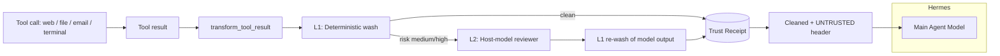

<div align="center">

# 🛡️ Hermes Room

**Turn untrusted web, email, file and tool output into safe context before Hermes reads it — with receipts.**


*Local-first sanitizer + Trust Receipt. Follows your Hermes Desktop model. No extra key.*

</div>

> A skill can tell Hermes to *be careful*. **Hermes Room changes the bytes Hermes receives** — deterministically, with model help for semantic attacks, and evidence you can audit.

## ✨ Features

- 🧼 **Deterministic wash (always, free, local)** — strips zero-width / bidi / control chars, ANSI escapes, hidden HTML, script/style payloads.
- 🔐 **Secret / DLP masking** — masks AWS keys, GitHub/GitLab/Slack/OpenAI/Google tokens, JWTs, generic `password=`/`secret=`/`api_key=` assignments, and full private-key blocks before the model sees them.
- 🤖 **Host-model reviewer (Mode 1)** — `ctx.llm.complete_structured` against *your active Hermes model*. No provider override, no extra API key. Runs only on suspicion.
- 🔗 **Link & hidden-content markers** — replaces invisible spans with visible `[hidden … removed]` markers; annotates label→href domain mismatch.
- 🧾 **Trust Receipt** — local JSONL: SHA-256, rule IDs, reviewer verdict, provider/model. Never raw content by default.
- 🔍 **Evidence tools** — `trust_receipt` (what changed) and `trust_report` (Markdown audit export).
- 🛠️ **Fail-open** — reviewer timeout/error → keep Layer 1 result, never break Hermes tool loop.

## 🏗️ How it works



**Layer 1** is stdlib-only and runs on every tool result. It strips controls / hidden HTML / addresses and masks leaked secrets. **Layer 2** runs only when Layer 1 flags something (or long imperative content), with strict caps: 20s timeout, 800 tokens, 8k chars.

## 🚀 Quickstart

```bash
# Install into Hermes
hermes plugins install hermes-room
hermes plugins enable hermes-room

# Verify (same checks catalog CI runs)
hermes plugins doctor . --ci
hermes plugins validate . --install-deps
```

Then in Hermes:

> Summarize `fixtures/poisoned.html`

Call `trust_receipt` to see what was removed. Run `tests/`:

```bash
python -m unittest discover -s tests -t . -v
```

### Demo variants

```bash
# 1. Poisoned page — hidden injection payload
fixtures/poisoned.html

# 2. Secret leak — fake AWS key / GitHub token / password / private key
fixtures/secret-output.txt
```

> Both fixture files contain **fake/example values only**.

## 🎬 Demo (90s)

1. Open `fixtures/poisoned.html` — harmless article + hidden injection payload.
2. Ask Hermes to summarize it.
3. `trust_receipt` → removed items, hash, reviewer verdict.
4. Ask *"What did you receive?"* — Hermes quotes cleaned content only.
5. `trust_report` → export Markdown.
6. Repeat with `fixtures/clean.html` — passes unchanged.
7. Repeat with `fixtures/secret-output.txt` — fake secrets are masked, receipt shows `secret_*` rule IDs.

## ⚙️ Mode 1 — why no extra key

You pick the model in **Hermes Desktop** as usual. Hermes Room calls:

```python
ctx.llm.complete_structured(instructions=..., input=..., json_schema=REVIEW_SCHEMA, purpose="hermes-room.sanitize")
```

No `provider=` / `model=` / `task=` override → uses your active provider/model, host-owned credentials, audited in `agent.log`. Clean content skips the call entirely.

## 🧩 Why plugin, not skill

| Skill | Hermes Room Plugin |
|---|---|
| Advice the model *may* follow | Rewrites bytes before context |
| Can't strip hidden Unicode/HTML reliably | Mechanical, tested pipeline |
| Self-reported, no evidence | Local receipts with hashes + verdicts |
| Needs model compliance | Works in CLI / gateway / cron / subagents |

## 🔒 Disclosure & honesty

- Modifies tool output **only when changes are made**; cleansed text gets `[UNTRUSTED source=… risk=…]` header.
- Receipts local: `~/.hermes/hermes-room/receipts.jsonl` (or `$HERMES_HOME/hermes-room/`). Raw content not stored by default.
- Uses your Hermes host model for bounded reviewer calls. No network beyond that, no Node/Docker, no credentials, no auto-approval, no wallet access.
- Reduces poisoned context — not a guarantee, not an approval system or sandbox.

## 📁 Project structure

```
hermes-room/
├── plugin.yaml          # manifest: hermes-room 0.2.0
├── __init__.py          # register(ctx): hook + tools
├── sanitizer.py         # Layer 1 deterministic wash
├── reviewer.py          # Layer 2 host-model reviewer (Mode 1)
├── receipts.py          # Trust Receipt store
├── schemas.py           # trust_receipt / trust_report
├── fixtures/            # poisoned / clean / hidden-unicode / ANSI / secret-output
├── tests/               # 9 unittest cases
├── README.md
├── ARCHITECTURE.md
├── LICENSE
└── .gitignore
```

## 🤝 Contributing & community

Issues/PRs welcome. Keep PRs stdlib-only, add fixtures + tests for new patterns, update README badges/version together.

## 📄 License

MIT. Built for the Hermes Agent Plugin Hackathon — `hermes plugins install hermes-room` should just work.

---

*Made locally, reviewed locally. Your data stays in your Room.*
